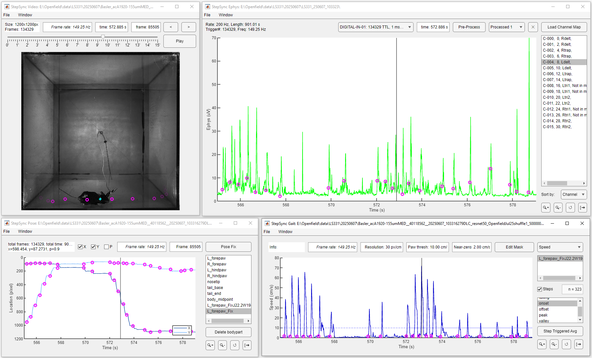

# KineSync

KineSync is a MATLAB application for aligning electrophysiology (such as EMG or LFP), video
and markerless pose tracking recorded during behavior, such as locomotion or licking.
It detects events from body-part trajectories and computes event-triggered averages
(ETA) of the ephys signal.



## Features

- **One shared timeline.** Video, ephys, pose and behavior windows follow the same
  cursor and zoom. Video frames are placed on the ephys clock using the camera
  TTL pulses recorded with the ephys data.
- **Ephys.** Reads Intan (`.rhd`/`.rhs`) and Open Ephys recordings. Preprocessing
  (high-pass filter, rectification, smoothing, down-sampling) can be chained,
  and channels can be labelled with a channel map.
- **Pose.** Reads DeepLabCut CSV, HDF5 and MAT files, and SLEAP exports in
  DeepLabCut CSV format. Tracking errors are corrected semi-automatically by
  segmenting each trajectory at jumps and interpolating through trusted
  segments. You can review and edit the result.
- **Behavior.** Detects events from body-part x, y or speed (threshold crossings,
  movement onset and offset, peaks, valleys). Time-based and trace-threshold masks
  exclude unwanted periods.
- **Event-triggered average.** Averages an ephys signal (for example rectified EMG) around behavioral events against a chosen
  null distribution (dithered, shuffled or random events), with a ±3 SD band.
- **Sessions and exports.** Saves and restores whole sessions. Writes corrected
  pose files, ephys and behavior `.mat` files, and videos with markers drawn in.

## Requirements

- MATLAB R2023a (the version KineSync was developed and tested with).
- Signal Processing Toolbox.
- For Open Ephys recordings only: [open-ephys-matlab-tools](https://github.com/open-ephys/open-ephys-matlab-tools)
  on the MATLAB path.

The Statistics and Machine Learning Toolbox is optional. It is only used by an
alternative jump-threshold method that the GUI does not call.

## Quick start

```matlab
% from the folder that contains KineSync.m
addpath(pwd)
KineSync('D:\my_data')   % the folder where file dialogs open first
```

The launcher opens with four buttons: **Video**, **Ephys**, **Pose** and
**Behavior**. A typical analysis:

1. **Ephys:** `File > Open` a recording folder. The digital channel menu draws
   a TTL channel over the trace.
2. **Video** (optional): `File > Open` the behaviour video.
3. **Pose:** `File > Open` the pose file, and correct tracking errors with **Pose Fix**.
4. **Synchronize** in the Ephys viewer: pair the camera TTLs with the frames,
   which puts Video, Pose and Behavior on the ephys clock.
5. **Behavior:** `File > Import Pose`, choose the body parts, set the threshold and mask,
   then open **Event Triggered Avg**.
6. `File > Save session` to keep everything.

The [Getting started](docs/getting-started.md) guide walks through this in
detail.

## Documentation

| Guide | Contents |
|---|---|
| [Getting started](docs/getting-started.md) | Installation, the launcher, menus, a first analysis |
| [Timing and synchronization](docs/synchronization.md) | How video frames are placed on the ephys clock |
| [Video viewer](docs/video.md) | Playback, pose markers, exporting marked videos |
| [Ephys viewer](docs/ephys.md) | Reading recordings, camera TTL, channel maps, preprocessing |
| [Pose viewer and correction](docs/pose.md) | Pose formats, frame alignment, the correction algorithm |
| [Behavior analysis](docs/behavior.md) | Event detection, event definitions, masks |
| [Event-triggered average](docs/eta.md) | ETA computation and null controls |
| [Sessions and files](docs/files.md) | Session files, saved data formats, workspace export |
| [Command-line functions](docs/functions.md) | Using preprocessing, pose correction, event detection and ETA in your own scripts |

Tests are described in [tests/README.md](tests/README.md).

## Citation

A methods paper describing KineSync is in preparation. Until it is published,
please cite this repository:

> *Citation to be added.*

## License

KineSync is released under the [MIT License](LICENSE).

Bundled third-party code keeps its own terms:

- `+Shared/fastsmooth.m` © 2012 Thomas C. O'Haver, MIT-style license (in the
  file header), modified to smooth matrices column-wise.
- `+Ephys/read_Intan_RHD2000.m` and `+Ephys/read_Intan_RHS2000.m` are adapted from
  the file readers published by Intan Technologies.
