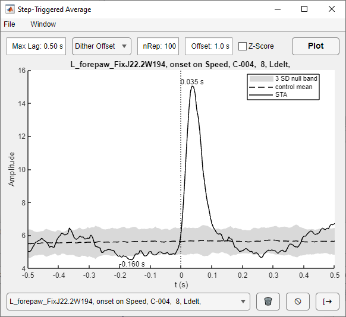

# Event-triggered average

The event-triggered average (ETA) is the mean ephys signal (for example rectified EMG) around each behavioral event. It
is compared with the average expected by chance, which shows whether the
signal is locked to the events, for example a muscle's activity to the step cycle.

## Choosing what to average

The ETA uses the current selections in the other viewers:

- **Ephys:** the data type (`Raw` or `Processed N`) and channel selected in the
  [Ephys viewer](ephys.md). Rectified, down-sampled data (the default
  preprocessing) gives the average muscle activation envelope.
- **Events:** the body part, trace and event type selected in the
  [Behavior viewer](behavior.md). Masked periods contain no events.

Click **Event Triggered Avg** in the Behavior viewer, set the parameters, and
click **Plot**.

| Parameter | Default | Description |
|---|---|---|
| Max Lag | 0.5 s | The average covers −Max Lag to +Max Lag around each event |
| Control | Dither Offset | The null distribution (see below) |
| nRep | 100 | Number of surrogate event sets for repeated controls |
| Offset | 1 s | Maximum shift for Dither Offset |
| Z-Score | off | Plot in units of the control SD |

## Computation

Each event time is converted to the nearest ephys sample on the shared clock
(see [Timing and synchronization](synchronization.md)). Time 0 is the event,
and positive lags are after it. Events outside the ephys recording are dropped
with a warning. The signal must be evenly sampled.

At each lag, the average is taken over the events whose sample at that lag
exists:

  ETA(τ) = Σₑ x(tₑ + τ) / Nₑ(τ)

where Nₑ(τ) counts the events with a valid sample at lag τ. Events near
the start or end of the recording, or next to missing samples, therefore
contribute only where they have data. Missing samples are never treated as
zeros. If two events fall on the same sample, both are counted.

## Controls

The control estimates the ETA expected if the signal and events were unrelated. It is
drawn as a dashed mean with a shaded ±3 SD band.

| Control | Surrogate events | Band |
|---|---|---|
| Dither Offset | Each real event shifted by a random offset, uniform in [−Offset, +Offset) | SD over nRep repetitions |
| ISI shuffle | The real inter-event intervals in random order | SD over nRep repetitions |
| Random time | The same number of events at uniformly random times | SD over nRep repetitions |
| Global (SEM) | None. Uses the overall signal mean | ≈ 3 × SD(x) / √N |
| No control | None | None |

**Dither Offset** keeps the slow structure of the event train while breaking
its precise timing to the signal. This controls for slow co-variation of the signal
and behavior, such as muscle activity and locomotion. Choose an offset longer than the movement cycle (for example the step cycle) but
shorter than changes in behaviour. **ISI shuffle** keeps
the interval distribution. **Random time** keeps only the event count.

Repeated controls compute nRep surrogate ETAs. If this is estimated to take
more than 5 seconds, KineSync offers to continue, switch to the Global
control, or skip the control.

With **Z-Score**, the plot shows (ETA − control mean) / control SD, so the
band is ±3.

## Reading the plot

- Black line: the ETA.
- Dashed line and shaded band: the control mean and ±3 SD.
- Dotted vertical line: the event (t = 0).
- Labels mark the times of the largest positive and negative deviations from
  the control mean.

## History

Every **Plot** adds a run to the history list at the bottom of the window. A
run stores the result, all parameters, the body part, event, trace, ephys type and
channel. Selecting a run shows it again with its parameters. 🗑️ deletes the
selected run, ⃠ clears all runs, and [➜ copies the plot into a MATLAB figure.

The history is kept in `data.behav.eta` (see
[Working with results in MATLAB](getting-started.md#working-with-results-in-matlab)),
and is saved with behavior files and sessions.
